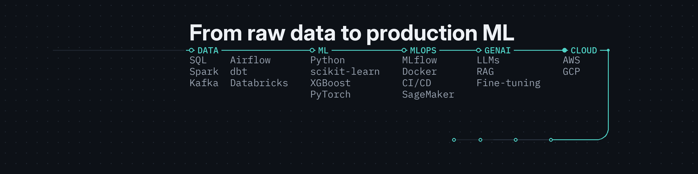

  

<h1 align="center">Carlos Galvan</h1>
<h3 align="center">Machine Learning Engineer | Data Engineering, Data Science | PEMEX | ex Kavak | M.Sc. Applied AI (in progress) @ Tec de Monterrey</h3>

  Villahermosa, Mexico · Open to Remote / Hybrid, relocate MX + abroad · English C2 (Cambridge CAE) · Spanish native

  
  
  

I build and operate production data pipelines and ML systems end to end: ingest, transform, serve, monitor. Most of my recent work sits at the intersection of **AWS data platforms**, **SQL/Spark-class processing**, and **applied ML / retrieval** when the product needs it.

---

## Stack

  

  <b>Data engineering</b> 
  
  
  
  
  
  
  

  <b>Cloud and warehouse</b> 
  
  
  
  
  
  
  
  

  <b>ML and MLOps</b> 
  
  
  
  
  

  <b>GenAI and NLP</b> 
  
  
  
  
  
  
  

  <b>BI</b> 
  
  

---

## Experience

### PEMEX · Machine Learning Engineer (Mar 2025 - Present)
I own the model pipeline end to end: ingestion, databases, CI/CD, MLOps, repos, monitoring and models in production. Reservoir Engineering from Mar 2025 to Jul 2026; Gerencia de Desarrollo e Innovación Tecnológica since Aug 2026.

**Data Engineering**
- Owned three Prefect-orchestrated ETL pipelines for daily industrial data feeds. Parallel task execution cut runtime 70%, from 68 to 10 minutes, and removed manual intervention.
- Built data quality and reconciliation steps (self-healing fuzzy matching for well IDs) so ML and operations users receive consistent daily feeds.
- Built the SQL and Python production path for about 140,000 daily records that feed the classifier below, and curated datasets from 16 years of production history across 33 wells for forecasting work.

**Data Science**
- Built a TF-IDF + LinearSVC classifier for about 140,000 daily well operation records: 96% accuracy across 44 operational concepts, cutting processing from hours to minutes.
- Ran model comparison and held-out validation across classical ML and deep learning candidates and documented results for engineering stakeholders.
- Feature engineering on production time series and operational text.

**AI & ML**
- Research paper (PEMEX project TT-632464): "Application of ML, Deep Learning, and PINNs for Early Water Breakthrough Prediction in Naturally Fractured Reservoirs". Ensemble of XGBoost, LightGBM, BiLSTM, Transformer and PINNs for 3 high-value wells; the ensemble predicted breakthrough within 2 days of the actual event and the Transformer alone had a median error of 23 days.
- Built a production RAG system for Spanish petroleum engineering documents, used by technical teams: hybrid retrieval (ChromaDB + BM25), conversation memory, and automated evaluation tracking Hit Rate, MRR and Precision@k.

*Stack: Python, SQL, Prefect, Docker, scikit-learn, XGBoost, LightGBM, PyTorch, ChromaDB*

### Kavak · Pricing Data Engineer (Aug 2022 - Mar 2025)
Data engineering for Kavak's marketplace pricing algorithms.

- Owned AWS pricing algorithm pipelines built on AWS Glue jobs, Step Functions state machines and Apache Airflow, processing millions of vehicle valuations.
- Built GitLab CI/CD for feature versioning and pipeline and model deployment, reducing deployment time about 60% and speeding up iteration on pricing algorithms.
- Optimized SQL-heavy ETL joins and transforms on Amazon Athena and Redshift Spectrum that feed pricing features; SageMaker paths for model-adjacent transforms.
- Operated Dockerized batch jobs for pricing, BI and data science consumers with reliable daily feature freshness, plus reusable transform components for feature delivery.

*Stack: Python, SQL, AWS Glue, AWS Step Functions, Apache Airflow, Amazon Athena, Amazon Redshift Spectrum, Amazon SageMaker, Docker, GitLab CI/CD*

### Kavak · Senior Pricing Analyst, Global Pricing & Strategy (Feb 2021 - Aug 2022)
Pricing and inventory analytics for Kavak's Global Pricing & Strategy team.

- Built early-warning analytics on negative-margin inventory that recovered $104M MXN and prevented about $1M MXN in monthly losses by flagging at-risk vehicles early.
- Developed predictive models using market price elasticity to guide purchasing and sales decisions, increasing average sales margins by 20% while reducing repair expenses through better vehicle quality standards.
- Designed and standardized weekly inventory, sales and purchase KPIs with the Data Science and Finance teams.
- Automated KPI reporting with SQL, Python (SQLAlchemy) and Tableau, cutting manual reporting about 80%.
- Built forecasting models for purchases, sales and gross profit to support pricing decisions.

*Stack: SQL, Python, SQLAlchemy, Tableau*

---

## Education

- **M.Sc. Applied Artificial Intelligence** · Tecnológico de Monterrey · 2025 - 2027 (current)  
  Recent coursework includes Big Data, NLP, MLOps (TC5061), software design (TC5062).
- **Certificate, Data Analytics and Visualization** · Tecnológico de Monterrey · 2022
- **B.S. Petroleum Engineering** · Universidad Olmeca · 2018

Coursework and public MSc materials: [github.com/carloshgalvan95/MNA](https://github.com/carloshgalvan95/MNA)

---

## Public repos

| Repo | Why it exists |
| --- | --- |
| [endzone-mlops](https://github.com/carloshgalvan95/endzone-mlops) | NFL pregame win-probability pipeline: Databricks + dbt marts, MLflow tracking and registry, GitHub Actions CI and a weekly [live page](https://carloshgalvan95.github.io/endzone-mlops/) with a public track record |
| [bch-balances-dbt](https://github.com/carloshgalvan95/bch-balances-dbt) | dbt on BigQuery: Bitcoin Cash address balances from the public dataset, partition-pruned window, data tests, keyless CI with Workload Identity Federation |
| [bch-balances-terraform](https://github.com/carloshgalvan95/bch-balances-terraform) | Terraform for the GCP side: project, BigQuery datasets, least-privilege service account and GitHub OIDC federation, no manual resources |
| [MNA](https://github.com/carloshgalvan95/MNA) | Applied AI master's work |
| [personal_finance_gui](https://github.com/carloshgalvan95/personal_finance_gui) | Small TypeScript finance tracker |
| [Square_Meter_Value_Real_Estate](https://github.com/carloshgalvan95/Square_Meter_Value_Real_Estate) | Feature analysis for price / m² |
| [World_Weather_Analysis](https://github.com/carloshgalvan95/World_Weather_Analysis) | API-driven weather / travel analysis |

Proprietary employer systems stay private; the bullets above are the parts I can describe publicly.

---

## Contact

- LinkedIn: [linkedin.com/in/carloshgalvan](https://www.linkedin.com/in/carloshgalvan/)
- Email: `carloshgalvan95@gmail.com`
- Phone: `+52 993 323 4114`
